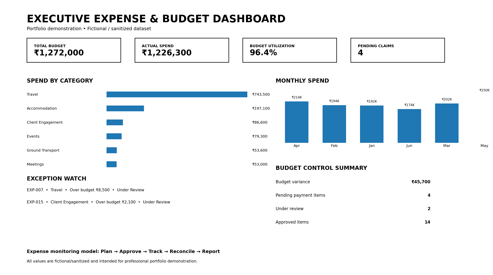

# Executive Expense & Budget Management

### Executive expense tracking, budget control, variance analysis and management reporting portfolio

> **Portfolio Demonstration:** This repository demonstrates an executive expense and budget management workflow using a fictional / sanitized dataset.

---

## 📊 Executive Expense & Budget Dashboard

---

## 🎯 Overview

This portfolio project demonstrates a structured approach to managing executive and operational expenses, monitoring budgets, identifying variances, tracking approvals, and preparing management-ready expense reporting.

The model is designed to support Executive Assistants, Executive Office teams, Operations Coordinators, and business support professionals responsible for financial administration and expense visibility.

### Workflow

**Plan → Approve → Track → Reconcile → Report**

---

## 🔑 Key Capabilities

- Executive expense tracking
- Budget vs. actual expense monitoring
- Budget utilization analysis
- Variance identification
- Expense approval tracking
- Payment status monitoring
- Department and cost-center tracking
- Exception and over-budget monitoring
- Monthly expense analysis
- Management reporting support
- Reconciliation-ready expense records

---

## 📈 Dashboard Components

The dashboard provides a management-level view of:

| Area | Purpose |
|---|---|
| Total Budget | Monitor planned expenditure |
| Actual Spend | Track recorded expenses |
| Budget Utilization | Measure spending against approved budget |
| Pending Claims | Identify unpaid or pending expenses |
| Spend by Category | Analyze expense distribution |
| Monthly Spend | Monitor spending trends |
| Budget Control | Compare planned vs. actual expenditure |
| Exception Watch | Highlight items requiring attention |

---

## 📁 Repository Contents

| File | Description |
|---|---|
| `expense-budget-tracker.csv` | Expense, budget, approval and payment tracking dataset |
| `executive-expense-dashboard.png` | Executive expense and budget management dashboard |
| `README.md` | Project documentation |

---

## 🧩 Expense Tracking Structure

The tracker captures:

- Expense Date
- Expense ID
- Expense Category
- Description
- Budget
- Actual Expense
- Variance
- Payment Status
- Approval Status
- Department
- Cost Center

This structure supports consistent tracking from expense submission through approval, payment and management reporting.

---

## 💼 Executive Office Application

This model can support executive-office activities such as:

- Executive travel expenses
- Accommodation and transportation
- Leadership meetings
- Client engagement expenses
- Business events
- Communication expenses
- Vendor-related expenditure
- Department-level expense monitoring
- Monthly management reporting

---

## 🛠️ Tools & Skills Demonstrated

- Microsoft Excel
- CSV-based data management
- Expense tracking
- Budget monitoring
- Variance analysis
- KPI reporting
- Management dashboards
- Executive reporting
- Data reconciliation
- Exception monitoring

---

## 🔄 Management Control Model

### 1. Plan
Establish budgets and expense categories.

### 2. Approve
Track approval status before expenditure is finalized.

### 3. Track
Record actual expenses against planned budgets.

### 4. Reconcile
Review payment status and identify outstanding items.

### 5. Report
Provide management-level visibility into spending, utilization and exceptions.

---

## ⚠️ Portfolio Disclaimer

All information, figures and records in this repository are **fictional / sanitized portfolio examples** created for demonstration purposes.

No confidential company, client, employee, vendor or financial information is included.

---

## 👤 Professional Focus

This project demonstrates capabilities relevant to:

- Senior Executive Assistant
- Executive Assistant
- Executive Office Support
- C-Suite Support
- Operations Coordinator
- Business Operations Support
- Management Reporting
- Administrative Operations

---

## 📌 Related Portfolio Areas

This project complements portfolio demonstrations covering:

- Executive Calendar Management
- Executive Meeting Management
- Executive Communication Management
- Executive Travel Management
- Document Management
- MIS & Reporting
- Executive Operations Management
- Process Improvement

---

**Portfolio:** Kiran Kumar Ambati  
**Focus:** Executive Office | C-Suite Support | Operations | MIS | Executive Coordination